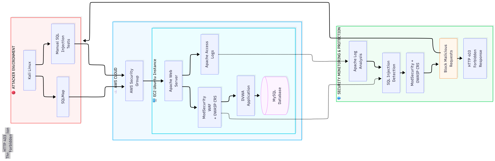

# SQL Injection Attack and Defense in a Cloud Environment

### AWS | Ubuntu Server | DVWA | SQLMap | ModSecurity | OWASP CRS


---

## 1. Project Overview

This project focuses on demonstrating a **SQL Injection (SQLi) attack and its prevention in a cloud environment** using Amazon Web Services (AWS).

The objective is to deploy a vulnerable web application on an AWS EC2 instance, simulate SQL Injection attacks using Kali Linux and SQLMap, and implement security mechanisms using ModSecurity Web Application Firewall (WAF) combined with the OWASP Core Rule Set (CRS).

The project demonstrates how cloud infrastructure and application-layer security mechanisms can work together to detect and block malicious HTTP requests.

## 2. Project Objectives

- Deploy a web application environment on AWS EC2.
- Configure an Ubuntu Server with Apache and MySQL.
- Deploy DVWA (Damn Vulnerable Web Application).
- Identify and exploit SQL Injection vulnerabilities in a controlled lab.
- Perform SQL Injection testing using SQLMap.
- Implement ModSecurity as a Web Application Firewall.
- Integrate OWASP Core Rule Set (CRS).
- Detect and block malicious HTTP requests.
- Analyze Apache and ModSecurity security logs.
- Evaluate the effectiveness of WAF protection.

## 3. Technical Architecture

The architecture consists of three main environments:

1. **Attacker Environment:** Kali Linux and SQLMap generate controlled SQL Injection requests.
2. **AWS Cloud Environment:** An Ubuntu EC2 instance hosts Apache, DVWA and MySQL.
3. **Security Monitoring & Protection:** ModSecurity and OWASP CRS inspect HTTP traffic, detect malicious requests and block suspicious activity.

### Architecture Diagram



### Architecture Components

| Component | Technology | Description |
|---|---|---|
| Attacker Machine | Kali Linux | Simulates SQL Injection attacks |
| Attack Tool | SQLMap | Automates SQL Injection testing |
| Cloud Provider | AWS | Hosts the cloud infrastructure |
| Compute | EC2 | Provides the virtual server |
| Operating System | Ubuntu Server | Hosts the web environment |
| Web Server | Apache | Handles HTTP requests |
| Vulnerable Application | DVWA | Provides a controlled SQLi testing environment |
| Database | MySQL | Stores application data |
| Web Application Firewall | ModSecurity | Inspects and filters HTTP requests |
| Security Rules | OWASP CRS | Detects common web attack patterns |
| Monitoring | Apache Logs | Records HTTP requests and server events |

## 4. Technologies and Tools

- **AWS:** EC2, Security Groups
- **Operating System:** Ubuntu Server
- **Web Technologies:** Apache, PHP
- **Database:** MySQL
- **Vulnerability Testing:** DVWA, SQLMap
- **Security:** ModSecurity, OWASP CRS
- **Monitoring:** Apache Access Logs, Apache Error Logs, ModSecurity Audit Logs
- **Testing Environment:** Kali Linux

## 5. Implementation Steps

### Phase 1 – AWS Infrastructure Deployment

- Create an AWS EC2 instance.
- Select Ubuntu Server as the operating system.
- Configure the Security Group.
- Allow SSH access from the authorized administrator IP.
- Restrict HTTP access to the authorized testing IP.
- Connect remotely to the instance using SSH.

### Phase 2 – Web Application Deployment

- Install Apache Web Server.
- Install PHP and required extensions.
- Install and configure MySQL.
- Deploy DVWA.
- Configure the application database.
- Complete the initial DVWA setup.

### Phase 3 – SQL Injection Attack Simulation

- Access the DVWA SQL Injection module.
- Configure the application security level for the controlled test.
- Perform manual SQL Injection testing.
- Use SQLMap to validate the vulnerability.
- Observe the application's response to malicious input.

### Phase 4 – WAF Implementation

- Install ModSecurity on the Apache server.
- Configure the ModSecurity engine.
- Integrate OWASP Core Rule Set.
- Enable security rules.
- Configure blocking mode.
- Verify that malicious requests are detected and denied.

### Phase 5 – Security Monitoring and Analysis

- Monitor Apache access logs.
- Analyze Apache error logs.
- Inspect ModSecurity audit logs.
- Identify suspicious HTTP requests.
- Verify WAF blocking decisions.
- Compare application behavior before and after WAF protection.

## 6. Attack Detection and Protection

The protection mechanism relies on the integration of ModSecurity and OWASP CRS.

When an HTTP request reaches the Apache server:

1. ModSecurity inspects the incoming request.
2. OWASP CRS evaluates the request against security rules.
3. Suspicious SQL Injection patterns are identified.
4. Requests matching blocking rules are denied.
5. The security events are recorded in the audit logs.

A blocked request typically returns:

**HTTP 403 – Forbidden**

The result must be correlated with the ModSecurity audit log to confirm that the WAF generated the blocking decision.

## 7. Repository Structure

```text
AWS-SQL-Injection-Defense/
│
├── README.md
│
├── docs/
│   └── architecture.png
│
├── scripts/
│   ├── 01_install_dvwa_modsecurity.sh
│   ├── 02_enable_waf.sh
│   ├── 03_test_waf.sh
│   └── 04_collect_logs.sh
│
├── screenshots/
│   ├── ec2-instance.png
│   ├── security-group.png
│   ├── dvwa-sqli-test.png
│   ├── sqlmap-results.png
│   ├── modsecurity-detection.png
│   └── http-403-response.png
│
└── evidence/
    └── README.md
```

## 8. Deployment and Execution

### Prerequisites

- AWS account.
- Ubuntu Server EC2 instance.
- SSH access and an SSH key pair.
- Kali Linux testing machine.
- Restricted AWS Security Group rules.

### Connect to the EC2 Instance

```bash
chmod 400 your-key.pem

ssh -i your-key.pem ubuntu@EC2_PUBLIC_IP
```

### Install the Environment

Clone the repository:

```bash
git clone https://github.com/USERNAME/AWS-SQL-Injection-Defense.git

cd AWS-SQL-Injection-Defense
```

Make scripts executable:

```bash
chmod +x scripts/*.sh
```

Run the installation script:

```bash
sudo bash scripts/01_install_dvwa_modsecurity.sh
```

### Configure DVWA

Access the application:

```text
http://EC2_PUBLIC_IP/dvwa/setup.php
```

Create or reset the DVWA database through the setup interface.

### Enable ModSecurity Protection

After validating the application in DetectionOnly mode:

```bash
sudo bash scripts/02_enable_waf.sh
```

### Test WAF Protection

```bash
sudo bash scripts/03_test_waf.sh
```

### Collect Security Logs

```bash
sudo bash scripts/04_collect_logs.sh
```

## 9. Expected Results

The project aims to demonstrate the following security outcomes:

| Test | Expected Result |
|---|---|
| Normal HTTP request | Application accessible |
| Manual SQL Injection test before WAF blocking | Vulnerability demonstrated |
| SQLMap controlled testing | SQLi behavior evaluated |
| Suspicious request with WAF enabled | Detection by ModSecurity |
| Malicious request matching a blocking rule | HTTP 403 Forbidden |
| Security log analysis | Attack events available for investigation |

*Actual results depend on the ModSecurity configuration, OWASP CRS version and application behavior.*

## 10. Security Considerations

- DVWA is intentionally vulnerable and must only be deployed in an isolated testing environment.
- Restrict access through AWS Security Groups.
- Never expose SSH access to the entire Internet.
- Do not use the testing commands against systems without explicit authorization.
- Avoid publishing AWS credentials, database passwords, private keys or session cookies.
- WAF protection should complement secure application development, not replace it.
- Parameterized SQL queries and secure coding practices remain essential to prevent SQL Injection.

## 11. Conclusion

This project demonstrates a practical approach to securing web applications hosted in a cloud environment.

By combining AWS infrastructure, vulnerability testing, ModSecurity and OWASP CRS, it illustrates how security controls can be implemented at both the network and application layers.

It also highlights the importance of continuous monitoring, attack detection and security log analysis in protecting cloud-hosted applications.

## 12. References

- [AWS EC2 Documentation](https://docs.aws.amazon.com/ec2/)
- [DVWA – Damn Vulnerable Web Application](https://github.com/digininja/DVWA)
- [ModSecurity](https://github.com/owasp-modsecurity/ModSecurity)
- [OWASP Core Rule Set](https://coreruleset.org/)
- [SQLMap](https://sqlmap.org/)
- [OWASP SQL Injection Prevention Cheat Sheet](https://cheatsheetseries.owasp.org/cheatsheets/SQL_Injection_Prevention_Cheat_Sheet.html)

---

**Author:** Laïla Hammouch

**Project Domain:** Cloud Security | Web Application Security | Vulnerability Assessment | WAF Implementation
